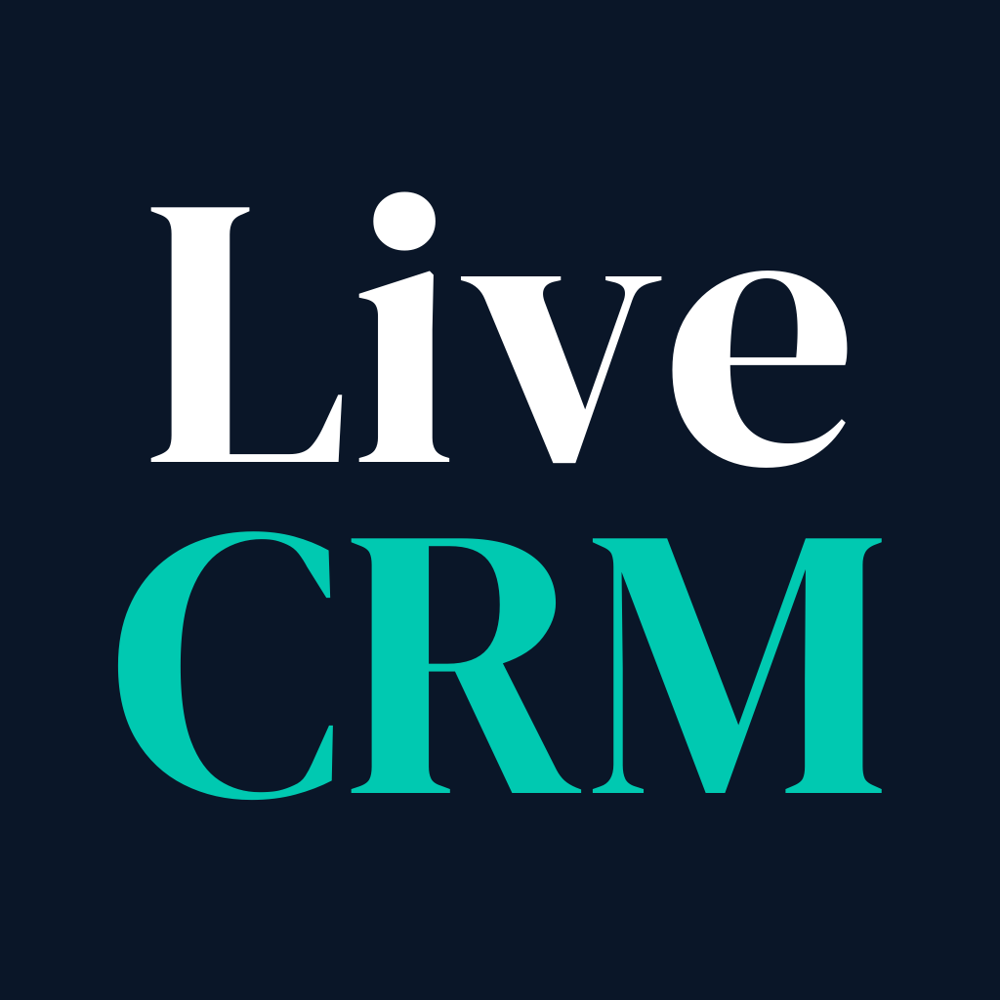

<p align="center"></p>

# LiveCRM MCP server

Typed, audited tools for Salesforce and HubSpot: deduplication, normalization, enrichment, assignment, job changes, record creation, mass update and segmentation. Reads are free and change nothing. Every write sits behind a permission you grant, and every write can be reversed.

**This is a hosted server.** This repository holds its documentation and registry metadata, not its source code. Using it needs a LiveCRM account.

- Server URL: `https://api.livecrm.ai/mcp` (Streamable HTTP, OAuth 2.1 with Dynamic Client Registration)
- Full documentation: [livecrm.ai/mcp](https://livecrm.ai/mcp)
- Claude connector directory: [claude.ai/directory/livecrm](https://claude.ai/directory/livecrm)
- Official MCP Registry: `ai.livecrm/livecrm`

Note the `api.` subdomain. livecrm.ai/mcp is the documentation page; api.livecrm.ai/mcp is the server, and the two are not interchangeable.

## Connect

You do not need to sign in first. If you are signed out when you connect, LiveCRM asks you to sign in or create an account, then returns you to the consent screen. If your company is new to LiveCRM, [start a free trial](https://livecrm.ai/trial). If it already uses LiveCRM, ask an admin for an invite.

### Claude

LiveCRM is in Claude's connector directory. Open [the listing](https://claude.ai/directory/livecrm) and connect.

### Claude Code

```bash
claude mcp add --transport http livecrm https://api.livecrm.ai/mcp
```

### Cursor

`~/.cursor/mcp.json`:

```json
{
  "mcpServers": {
    "livecrm": {
      "url": "https://api.livecrm.ai/mcp"
    }
  }
}
```

### VS Code

`.vscode/mcp.json`:

```json
{
  "servers": {
    "livecrm": {
      "type": "http",
      "url": "https://api.livecrm.ai/mcp"
    }
  }
}
```

Any other client that supports remote MCP servers with OAuth works the same way: give it the server URL.

## Try asking

- How many of our contacts have no email address?
- Find duplicate accounts and show me the groups you are most sure about.
- Which of our contacts have changed jobs recently?
- Standardize the job titles on our contacts, and show me what would change before anything is written.
- What did LiveCRM change in our CRM this week? Undo the last change.

## Tools

Sixty tools. Thirty only read: they answer from LiveCRM's own mirror of your CRM and never touch the CRM itself. Thirty change something, and each sits behind a named permission. Every tool declares whether it reads, whether it destroys, and whether it reaches outside LiveCRM, so your client can decide what needs confirming.

### Read

| Permission | Tools |
|---|---|
| `crm:read` | `count_crm_records`, `get_crm_record`, `list_crm_connections`, `list_crm_users`, `list_filterable_fields` |
| `runs:read` | `get_plan`, `get_readiness_recommendations`, `get_run`, `get_run_records`, `list_employer_changes`, `list_plans`, `list_runs`, `list_search_criteria`, `preview_plan_reversal` |
| `runs:preview` | `preview_enrichment_run`, `preview_records_run` |
| `templates:read` | `get_assignment_config`, `get_default_rule_config`, `get_normalize_catalog`, `get_rule_template`, `get_tam`, `get_tam_outward`, `list_rule_templates`, `preview_normalize_scheme` |
| `dedup:read` | `get_duplicate_group`, `list_duplicate_groups` |
| `audit:read` | `get_audit_event_records`, `list_audit_events` |
| `queue:read` | `list_queue_actions`, `list_queue_history` |

### Change

| Permission | Tools |
|---|---|
| `runs:create` | `create_alert_run`, `create_assignment_run`, `create_deduplication_run`, `create_enrichment_run`, `create_job_change_run`, `create_mass_update_run`, `create_normalize_run`, `create_plan`, `create_records_run`, `create_score_run`, `create_segmentation_run`, `create_verification_run`, `set_plan_schedule`, `update_plan_inputs` |
| `runs:dispatch` | `dispatch_run`, `fire_plan`, `run_job_change_sweep` |
| `runs:reverse` | `reverse_audit_event` |
| `runs:delete` | `delete_run` |
| `templates:write` | `create_rule_template`, `delete_rule_template`, `set_assignment_config`, `set_contact_owner_inheritance`, `set_new_employer_record`, `set_owner_mode`, `set_tam`, `update_rule_template` |
| `dedup:merge` | `approve_duplicate_group`, `reverse_duplicate_group` |
| `queue:propose` | `queue_action` |

Creating a run and dispatching it are separate permissions. An agent holding `runs:create` without `runs:dispatch` can research your CRM and compose the exact fix, but cannot write a single field until a person dispatches it.

## Security and privacy

- [Security overview](https://livecrm.ai/security)
- [Privacy policy](https://livecrm.ai/privacy)
- [Subprocessors](https://livecrm.ai/subprocessors)

## Support

Email [jaime@livecrm.ai](mailto:jaime@livecrm.ai). Issues on this repository are for the documentation only.

## License

The contents of this repository are released under the [MIT License](LICENSE). The LiveCRM service itself is governed by the [Master Subscription Agreement](https://livecrm.ai/msa).
